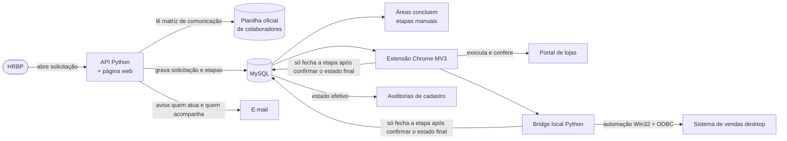
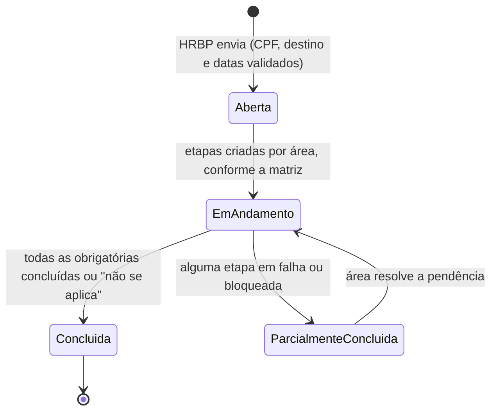
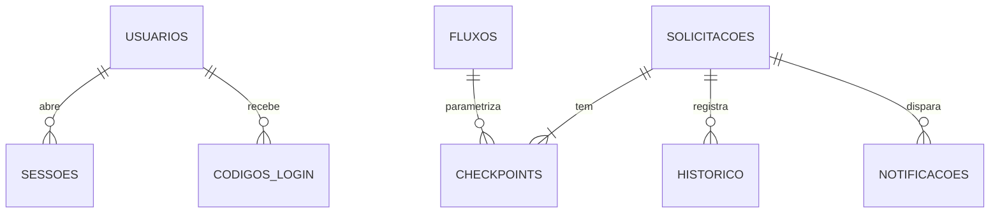

# Gestão de Colaboradores — estudo de caso

Plataforma interna que mantém o cadastro de pessoas consistente entre quatro sistemas de uma rede de varejo (portal de gestão de lojas, sistema de vendas desktop, ERP e plataforma de treinamento) e transforma transferências e promoções num fluxo com etapas, responsáveis e prova de execução.

> Este repositório é um **estudo de caso**. O código é de uso interno e não está publicado; aqui estão a arquitetura, as regras e as decisões de projeto, sem dados reais.

**Em produção para 31 usuários** de RH, operação e TI.

---

## O problema

- Uma transferência de loja era um e-mail e a esperança de que cada área fizesse a sua parte.
- O mesmo colaborador precisava ser alterado à mão em quatro sistemas, cada um com sua própria chave de identidade.
- Auditorias de cadastro desfaziam transferências que ainda estavam em andamento.
- Ninguém sabia em que etapa cada pedido estava.

## A solução em uma imagem

## Módulos

| Módulo | O que faz | Onde age |
| --- | --- | --- |
| Unidades | Atualiza, limpa e valida o cadastro de lojas | Portal de lojas (DOM) |
| Colaboradores | Auditoria, diagnóstico, execução em lote e importação em massa | Portal de lojas (DOM) |
| Sistema de vendas | Auditoria e execução de ações de usuário | Aplicação desktop, via bridge Win32 + ODBC |
| Movimentações | Workflow de transferência definitiva, temporária e promoção | API + banco + os dois executores acima |

## Como uma movimentação anda

Transferências temporárias têm vigência: três dias antes do fim, quem abriu recebe um e-mail para renovar. Sem renovação, a movimentação é encerrada na data e todos são avisados do retorno à loja de origem. A rotina roda ao iniciar o serviço e a cada 6 horas, sempre por data, então uma máquina desligada não perde aviso.

## Decisões de projeto

**O sistema inativa, nunca exclui.** A exclusão física é bloqueada no código antes de qualquer clique. Cadastro inativo com o mesmo CPF é histórico, não duplicidade.

**A trava fica onde a gravação passa.** Existe uma trava geral que bloqueia toda escrita. Ela é verificada no service worker da extensão, por onde toda gravação passa; travar só na interface seria uma trava decorativa.

**Etapa automática não fecha na mão.** As etapas executadas por robô só são concluídas pela rota do executor, depois que a ação rodou e a pós-validação confirmou o estado final no sistema de destino.

**Login sem senha, com prova de posse do e-mail.**
- A pessoa informa o e-mail corporativo e recebe um código de 6 dígitos, válido por 10 minutos e de uso único.
- O banco guarda só o hash SHA-256 do código e do token de sessão.
- A conferência é feita em tempo constante, com no máximo 5 tentativas por código.
- A resposta é a mesma para e-mail cadastrado e não cadastrado, para não revelar quem usa o sistema.
- A identidade do chamador vem sempre da sessão; o cliente não consegue dizer quem é.

**Visibilidade decidida no servidor.** Cada consulta recebe uma cláusula SQL de escopo: administrador vê tudo, quem abriu vê as suas, quem atua vê aquelas em que tem etapa, e quem responde por lojas vê o que entra e sai delas. Escopo vazio não libera nada.

**Uma regra, uma cópia.** A matriz de quem atua e quem é notificado é resolvida só no servidor; listas de destinatários vindas do cliente são ignoradas.

**Ler planilha pelo nome do cabeçalho, nunca pela posição.** Uma coluna deslocada gravaria dados errados em massa, sem aviso. Quando a planilha oficial perdeu duas colunas, nada quebrou.

**Importações com prévia.** A importação de acessos devolve primeiro o que faria e só grava quando confirmada. E-mail que não casa não é "corrigido no chute": vai para revisão com o palpite mais próximo.

## Modelo de dados

## Stack

| Camada | Tecnologia |
| --- | --- |
| Extensão | JavaScript, Chrome Manifest V3 (service worker, content scripts, native messaging) |
| API e página web | Python, HTTPS com certificado próprio |
| Banco | MySQL |
| Automação desktop | Python (automação Win32 + ODBC), launcher nativo em C# |
| Integrações | Outlook (e-mail), planilha oficial de colaboradores, ERP |
| Instalação | Scripts `.bat` e PowerShell numerados, um instalador único para quem não programa |

## Próximo passo do projeto

Sair da estação de trabalho para um servidor com DNS público e certificado emitido por autoridade pública, para atender os usuários externos sem VPN.

---

Autor: **Vitor Bellido** · [Portfólio](https://vhbellido.github.io) · [LinkedIn](https://www.linkedin.com/in/vitorbellido)
